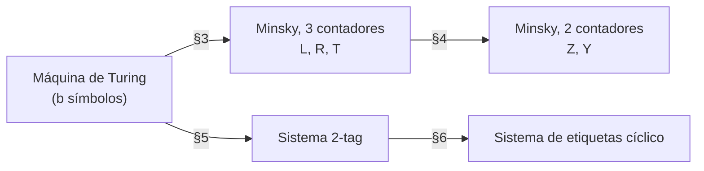

# Máquinas de Minsky y sistemas de etiquetas

Simulación de máquinas de Turing con dos contadores y con sistemas 2-tag, mediante traducciones implementadas y verificadas.

## 1. Enunciado

**Teorema (Minsky 1961, 1967).** Para toda máquina de Turing $M$ existe una máquina de Minsky $C_M$ con dos contadores tal que, si $C_M$ arranca con $Z = 2^{L_0}3^{R_0}$ e $Y = 0$, donde $L_0, R_0$ codifican la cinta inicial de $M$, entonces $C_M$ para si y sólo si $M$ para, y en ese caso $Z$ codifica la cinta final de $M$.

El proyecto construye $C_M$ a partir de $M$ en dos traducciones y añade una ruta paralela por sistemas de etiquetas:



Cada traducción se justifica con invariantes y un lema de simulación paso a paso (§3 a §6). Además, un simulador de referencia de la MT, que trabaja sobre la cinta explícita y no sobre la codificación numérica, se compara configuración a configuración con lo que se decodifica de cada modelo (§8). Esta comprobación no sustituye a una prueba formal mecanizada, pero detecta cualquier error en una macro o en una producción como una divergencia de trazas.

## 2. Modelos

### 2.1 Máquina de Turing

Cinta bi-infinita sobre $\Sigma = \{0, \dots, b-1\}$, con 0 como blanco; conjunto finito de estados $Q$; función parcial $\delta(q, s) = (q', w, d)$ con $d \in \{L, R\}$. La máquina para cuando $\delta(q, s)$ no está definida.

### 2.2 Máquina de Minsky

Contadores con valores en $\mathbb N$ y un programa con tres instrucciones (Minsky 1967, cap. 11):

| instrucción | efecto |
|---|---|
| `INC r, j` | $r \leftarrow r + 1$; ir a $j$ |
| `DEC r, j, k` | si $r > 0$: $r \leftarrow r - 1$, ir a $j$; si $r = 0$: ir a $k$ |
| `HALT` | parar |

Modelos equivalentes aparecen en Melzak (1961), Lambek (1961) y Shepherdson y Sturgis (1963). En Minsky (1961) la máquina se presenta como una MT de dos cintas que no escribe: una cabeza sobre una cinta semi-infinita sin escritura equivale a un contador.

### 2.3 Sistemas de etiquetas

Un $m$-tag consta de un alfabeto finito, un número de borrado $m$ y una producción $P(a)$ por símbolo. Con palabra $a_1 a_2 \cdots a_n$, un paso lee $a_1$, añade $P(a_1)$ al final y borra los $m$ primeros símbolos. Para si $n < m$ o si $a_1$ no tiene producción. Sólo se leen los símbolos situados en posiciones congruentes con 0 módulo $m$ respecto del punto de lectura.

Post estudió estos sistemas hacia 1921 y los publicó en 1943. Minsky (1961) demostró la indecidibilidad del problema de parada para sistemas de etiquetas; Cocke y Minsky (1964) la obtuvieron con $m = 2$, que es el mínimo posible.

### 2.4 Sistemas de etiquetas cíclicos

Alfabeto $\{0, 1\}$ y lista cíclica de producciones $p_0, \dots, p_{N-1}$. En el paso $t$ se borra el primer bit y, si era 1, se añade $p_{t \bmod N}$ (Cook 2004).

## 3. MT a 3 contadores

Implementación: `src/minsky/translate/TmToCounters.java`.

### 3.1 Codificación

Para una configuración con cabeza en la posición $h$:

$$L = \sum_{i \ge 0} \mathrm{cinta}[h-1-i]\, b^i, \qquad R = \sum_{i \ge 0} \mathrm{cinta}[h+i]\, b^i.$$

Cada mitad de la cinta es una pila cuyo tope es el dígito menos significativo. El símbolo leído es $R \bmod b$. La codificación es única porque el blanco es 0.

Con $s = R \bmod b$, $\rho = R \operatorname{div} b$ y $\delta(q, s) = (q', w, d)$:

| $d$ | $L'$ | $R'$ |
|---|---|---|
| $R$ | $Lb + w$ | $\rho$ |
| $L$ | $L \operatorname{div} b$ | $(\rho b + w)b + (L \bmod b)$ |

`TuringMachine.step` implementa esta tabla y los tests la contrastan con la simulación sobre cinta explícita.

### 3.2 Macros

$T$ es auxiliar y vale 0 entre macros.

```text
MOVE(X -> Y, k):  bucle: DEC X, sig, fin; INC Y (k veces); ir a bucle
MUL(X, b):        MOVE(X -> T, b); MOVE(T -> X, 1)
DIVMOD(X, b):     bucle: DEC X -> (cero) RESTO_0
                         DEC X -> (cero) RESTO_1
                         ...
                         DEC X -> (cero) RESTO_{b-1}
                         INC T; ir a bucle
```

Al salir por `RESTO_j` se cumple $X = 0$, $T = X_0 \operatorname{div} b$ y $j = X_0 \bmod b$. El resto no se almacena en un contador: queda determinado por la instrucción a la que se salta.

### 3.3 Bloque de un estado

```text
Q_q:   INC T; DEC T                   punto de control: T = 0, (L, R) codifica la configuración
       DIVMOD(R, b)                   salida por RESTO_s
RESTO_s:
       MOVE(T -> R, 1)                R := R div b
       sin transición:  MUL(R, b); R += s; HALT
       d = R:           MUL(L, b); L += w; ir a Q_q'
       d = L:           MUL(R, b); R += w; MUL(R, b);
                        DIVMOD(L, b) -> RESTO'_t: MOVE(T -> L, 1); R += t; ir a Q_q'
```

El par `INC T; DEC T` es una instrucción nula que deja el punto de control fuera de cualquier bucle.

### 3.4 Corrección

**Lema 1.** Con $T = 0$ al inicio, `MOVE(X -> Y, k)` termina con $X = 0$ e $Y$ incrementado en $kX$ tras $(k+1)X + 1$ pasos; `MUL` multiplica por $b$ y deja $T = 0$; `DIVMOD` termina en `RESTO_{X mod b}` con $T = X \operatorname{div} b$ y $X = 0$. Se prueba por inducción sobre $X$.

**Lema 2.** Si en `Q_q` los contadores valen $(L, R, 0)$ y codifican la configuración $c$, la máquina llega a `Q_{q'}` con $(L', R', 0)$ codificando el sucesor de $c$, o para con $(L, R, 0)$ si $c$ es terminal. Se obtiene componiendo el lema 1 con la tabla de 3.1.

**Teorema 1.** Por inducción sobre el número de pasos, la sucesión de valores en los puntos de control es la traza codificada de la MT.

## 4. k contadores a 2 contadores

Implementación: `src/minsky/translate/CountersToTwo.java`. Se aplica a cualquier máquina de $k$ contadores.

### 4.1 Codificación de Gödel

$$Z = p_0^{c_0} p_1^{c_1} \cdots p_{k-1}^{c_{k-1}}, \qquad Y = 0.$$

Para la máquina de 3.3, $Z = 2^L 3^R 5^T$.

### 4.2 Macros

```text
INC c_i, j:   Z := Z * p_i
    bucle: DEC Z, sig, vuelta; INC Y (p_i veces); ir a bucle
    vuelta: DEC Y, sig, j; INC Z; ir a vuelta

DEC c_i, j, k:   ¿p_i divide a Z?
    div: DEC Z -> (cero) r_0; ...; DEC Z -> (cero) r_{p-1}; INC Y; ir a div
    r_0: Z := Y; ir a j                      divisible: c_i > 0, Z ya dividido
    r_m: Z := Y * p_i + m; ir a k            no divisible: c_i = 0, Z restaurado
```

### 4.3 Corrección

**Lema 3.** Con $Y = 0$, la macro de `INC c_i` termina con $Z p_i$ e $Y = 0$; la de `DEC c_i` termina en $j$ con $Z / p_i$ si $c_i > 0$, o en $k$ con $Z$ sin cambios si $c_i = 0$. Se sigue de la factorización única: $p_i \mid Z \iff c_i > 0$.

**Teorema 2.** Las entradas a las macros están en biyección con los pasos de la máquina de $k$ contadores, y en ellas $Z$ codifica sus registros.

**Corolario.** Componiendo los teoremas 1 y 2, una máquina de dos contadores simula cualquier MT. Entrada: $Z_0 = 3^{R_0}$, puesto que $L_0 = T_0 = 0$. Salida: los exponentes de 2 y 3 en $Z$ al parar.

### 4.4 Coste y codificación

Si la MT usa $n$ celdas, $L, R < b^n$ y $Z \approx 2^L 3^R$ es doblemente exponencial en $n$. Cada macro recorre $Z$ de unidad en unidad, de modo que un paso de la MT cuesta del orden de $Z$ instrucciones. En los ejemplos de §8.3, 8 pasos de la suma unaria requieren $2{,}68 \cdot 10^{44}$ instrucciones.

La codificación de la entrada forma parte del enunciado. Schroeppel (1972) demostró que una máquina de dos contadores que recibe $N$ en un contador no puede calcular $2^N$, de modo que no puede producir por sí misma la entrada $3^{R_0}$. Dershowitz (2021) analiza la diferencia entre comparar modelos por inclusión de funciones y por simulación bajo codificación, usando este caso como ejemplo.

Con una sola instrucción de incremento y decremento, un contador no basta. Si se admiten multiplicación y división por constantes (Minsky 1967, §14.2), basta un registro; esa es la base de FRACTRAN (Conway 1987).

## 5. MT a 2-tag

Implementación: `src/minsky/translate/TmToTag.java`. Sigue el esquema de Cocke y Minsky (1964): cada lado de la cinta se representa en unario dentro de la palabra y cada pasada completa duplica, divide por dos o copia los bloques. Para tratar los dos sentidos de movimiento con las mismas reglas se añade una orientación a la configuración; esta variante es propia de esta implementación.

### 5.1 Configuración con orientación

Se usa $(q, o, u, v)$ con $o \in \{R, L\}$, donde $v$ es el bloque que contiene la cabeza en su bit menos significativo y $u$ es el otro lado sin la celda leída.

* $o = R$: $L = u$, $R = v$.
* $o = L$: $L = v \operatorname{div} 2$, $R = 2u + (v \bmod 2)$.

Con $r = v \bmod 2$ y $\delta(q, r) = (q', w, d)$:

| caso | configuración siguiente |
|---|---|
| $d = o$ | $(q', o, 2u + w, v \operatorname{div} 2)$ |
| $d \ne o$ | $(q', \bar o, 2(v \operatorname{div} 2) + w, u)$ |

En el segundo caso con $o = R$, $d = L$: la nueva celda leída es el bit bajo de $u$, luego el nuevo bloque con cabeza es el lado izquierdo completo, $v' = u$; el nuevo lado derecho sin cabeza es la celda escrita seguida del resto, $u' = 2(v \operatorname{div} 2) + w$. Los demás casos son simétricos. Así sólo se lee el bit bajo de $v$.

### 5.2 Palabra canónica

Con $S = (q, o)$ y un símbolo de relleno $x$ que nunca se lee:

$$W_S(u, v) = A_S\, x\, (a_S\, x)^u\, B_S\, x\, (b_S\, x)^v.$$

### 5.3 Lectura de la paridad

En un 2-tag, al recorrer un bloque de longitud $\ell$ desde una posición de lectura se leen $\lceil \ell / 2 \rceil$ símbolos; si $\ell$ es impar, el último borrado elimina el primer símbolo que sigue al bloque y la fase de lectura se desplaza una posición. La construcción usa este desplazamiento para leer la paridad de un número escrito en unario.

### 5.4 Pasadas

| pasada | producciones | resultado |
|---|---|---|
| 1 | $A \to C\,x$, $a \to c\,x$, $B \to D$, $b \to d$ | $C\,x\,(c\,x)^u\,D\,d^v$ |
| 2 | $K \to K_1 K_0$ para $K \in \{C, c, D, d\}$ | el bloque $D\,d^v$ mide $v + 1$; se leen $\lfloor v/2 \rfloor$ símbolos $d$ y la fase queda desplazada si $v$ es par. En la pasada 3 se leen los símbolos de índice $r = v \bmod 2$ |
| 3, $d = o$ | $C_r \to [J]\,A'x\,(a'x)^w$, $c_r \to a'x\,a'x$, $D_r \to B'x$, $d_r \to b'x$ | $W_{S'}(2u + w, \lfloor v/2 \rfloor)$ |
| 3, $d \ne o$ | $C_r \to [J]\,\tilde B'x$, $c_r \to \tilde b'x$, $D_r \to A'x\,(a'x)^w$, $d_r \to a'x\,a'x$ | $\tilde B'x\,(\tilde b'x)^u\,A'x\,(a'x)^{2\lfloor v/2 \rfloor + w}$ |
| 4, sólo si $d \ne o$ | $\tilde B \to B\,x$, $\tilde b \to b\,x$ | $W_{S'}(2\lfloor v/2 \rfloor + w, u)$ |

$J$ sólo se añade cuando $r = 0$ y es el símbolo que absorbe el desplazamiento de fase, de modo que la pasada siguiente empieza alineada. Para los pares $(q, r)$ sin transición no se define producción de $C_{S,r}$: la MT para exactamente cuando el sistema lee ese símbolo. La pasada 4 rota la palabra: al ser una cola, el bloque $\tilde B$ reaparece al final, detrás del bloque $A$.

### 5.5 Corrección y tamaño

**Lema 4.** Cada fila de la tabla anterior es un lema de conteo. Todos los bloques producidos tienen longitud par salvo $D\,d^v$, por lo que la alineación sólo cambia en la pasada 2, según la paridad de $v$ (5.3), y la pasada 3 la restablece mediante $J$.

**Teorema 3.** Para toda MT binaria con conjunto de estados $Q$ y $|\delta|$ transiciones definidas, el 2-tag construido tiene exactamente $20|Q| + 8|\delta|$ producciones, y las palabras que empiezan por un símbolo $A_S$ son exactamente las $W_S(u, v)$ correspondientes a las configuraciones sucesivas de la MT.

Un paso de la MT cuesta $O(u + v)$ pasos del tag. Como $u$ y $v$ son exponenciales en la longitud de la cinta, la simulación es exponencial. Woods y Neary (2006) probaron que los 2-tag simulan MT en tiempo polinómico, a través de sistemas cíclicos.

### 5.6 Traza

Inicio de `output/castor-2_traza_2tag.txt` (castor afanoso de 2 estados, cinta en blanco):

```text
   0  A<A,R> x B<A,R> x                      W(0,0), estado A
   2  C<A,R> x D<A,R>                        fin de la pasada 1
   3  D<A,R> C<A,R,1> C<A,R,0>               D d^0 tiene longitud impar
   4  C<A,R,0> D<A,R,1> D<A,R,0>             se lee el índice 0: la celda vale 0
   5  D<A,R,0> J A<B,R> x a<B,R> x           delta(A,0) = (B,1,R): u = 2*0 + 1
   6  A<B,R> x a<B,R> x B<B,R> x             W(1,0), estado B
  13  c<B,R,0> D<B,R,1> D<B,R,0> J Bt<A,L> x delta(B,0) = (A,1,L): cambio de orientación
  17  A<A,L> x a<A,L> x B<A,L> x b<A,L> x    tras la rotación
```

## 6. 2-tag a sistema cíclico

Implementación: `src/minsky/translate/TagToCyclic.java`, según Cook (2004). Con alfabeto $\{s_1, \dots, s_k\}$:

* $s_i \mapsto 0^{i-1} 1\, 0^{k-i}$;
* lista cíclica de $km$ producciones: $\mathrm{cod}(P(s_1)), \dots, \mathrm{cod}(P(s_k))$ seguidas de $k(m-1)$ producciones vacías.

Al leer los $k$ bits de $s_i$, el único 1 coincide con la producción $\mathrm{cod}(P(s_i))$; las $k(m-1)$ producciones vacías consumen los $m - 1$ símbolos siguientes. Un paso del $m$-tag equivale a $km$ pasos cíclicos. Cook usó esta reducción para probar la universalidad de la Regla 110.

## 7. Collatz en un 2-tag

De Mol (2008) dio el 2-tag $a \to bc$, $b \to a$, $c \to aaa$. Partiendo de $a^n$, la siguiente palabra formada sólo por $a$ es $a^{n/2}$ si $n$ es par y $a^{(3n+1)/2}$ si es impar, de modo que la parada de este sistema para todo $n$ equivale a la conjetura de Collatz. `TagSystemTest.collatzDeMol` lo comprueba para $2 \le n < 60$.

## 8. Implementación

### 8.1 Estructura

```text
src/minsky/
  tm/          TuringMachine, Config, Transition, Run
  cm/          Instr, Assembler, CounterMachine, Result, NonTerminationException
  tag/         TagSystem, TagResult, CyclicTagSystem
  translate/   TmToCounters, CountersToTwo, TmToTag, TagToCyclic, Sym
  Examples.java, Pipeline.java, Main.java
test/minsky/   CounterMachineTest, TranslationTest, TagSystemTest, RandomMachines
output/        programas compilados, producciones, traza y tabla de resultados
pom.xml
```

Java 17 o superior, sin dependencias en tiempo de ejecución; JUnit 4.13.2 para los tests. Los contadores y los pasos usan `BigInteger`.

### 8.2 Simulación acelerada

La máquina de dos contadores no puede ejecutarse instrucción a instrucción en un tiempo razonable. `CounterMachine.run` detecta ciclos simples: desde un `pc`, siguiendo siempre la rama no cero, se vuelve a `pc` tras $\ell$ instrucciones con incrementos netos $\delta_c$ y mínimos de prefijo $\mu_c \le 0$. Si los contadores valen $v_c$, el número de vueltas en que todos los `DEC` encuentran el contador positivo es

$$N = \min_{c:\, \delta_c < 0} \left( \left\lfloor \frac{v_c + \mu_c}{-\delta_c} \right\rfloor + 1 \right),$$

o 0 si algún $v_c + \mu_c < 0$. Durante esas $N$ vueltas el camino está determinado, y se aplican de una vez: $v_c \mathrel{+}= N\delta_c$ y pasos $\mathrel{+}= N\ell$. El resultado es exacto; los tests comparan ambos modos en registros, contador de programa y número de pasos.

### 8.3 Verificación y resultados

| comprobación | casos |
|---|---|
| paso aritmético frente a cinta explícita | 100 MT aleatorias, $b \in \{2, 3\}$ |
| 3 contadores frente a la MT | 5 ejemplos, 150 MT aleatorias, $b \in \{2, 3, 4\}$ |
| 2 contadores frente a la MT | 5 ejemplos, 80 MT aleatorias, $b \in \{2, 3\}$ |
| 2-tag frente a la MT | 4 ejemplos, 150 MT aleatorias |
| $k$ a 2 contadores en programas arbitrarios | 400 programas aleatorios (se comparan los que paran) |
| simulación acelerada frente a ingenua | 300 programas, 40 máquinas de 2 contadores |
| sistema cíclico frente a tag | Collatz, MT compilada, 30 sistemas aleatorios |

Las MT aleatorias incluyen máquinas que paran y máquinas que no; en estas últimas se comparan los primeros pasos. Salida de `minsky.Main`:

| MT | entrada | cinta final | pasos MT | instr. 3C | pasos 3C | instr. 2C | pasos 2C | prod. 2-tag | pasos 2-tag | palabra máx. |
|---|---|---|---|---|---|---|---|---|---|---|
| castor-2 | ε | `11[1]1` | 6 | 96 | 264 | 1632 | 9,97·10¹⁰ | 92 | 113 | 20 |
| castor-3 | ε | `111[1]11` | 14 | 118 | 866 | 2021 | 1,15·10²² | 128 | 531 | 66 |
| incremento binario, 11 + 1 | `1101` | `[0]011` | 10 | 248 | 1225 | 4365 | 1,44·10³⁶ | 220 | 435 | 54 |
| suma unaria, 3 + 2 | `111011` | `1111[1]` | 8 | 121 | 963 | 2119 | 2,68·10⁴⁴ | 120 | 852 | 130 |
| incremento ternario, 17 + 1 | `221` | `[0]2` | 3 | 115 | 131 | 1840 | 3,65·10⁹ | n/a | n/a | n/a |

Los números se escriben con el dígito menos significativo a la izquierda, bajo la cabeza: `[0]011` representa 12. El coste es lineal en los valores de $L$ y $R$ para 3 contadores, exponencial en la longitud de la cinta para el 2-tag y doblemente exponencial para 2 contadores.

### 8.4 Compilación y ejecución

Con Maven:

```bash
mvn test
mvn package
java -jar target/minsky-tag-1.0.jar output --trace
```

Sin Maven:

```bash
mkdir -p build/classes build/test-classes
javac -d build/classes $(find src -name '*.java')
java -cp build/classes minsky.Main output
CP=build/classes:build/test-classes:junit-4.13.2.jar:hamcrest-core-1.3.jar
javac -cp $CP -d build/test-classes $(find test -name '*.java')
java -cp $CP org.junit.runner.JUnitCore minsky.CounterMachineTest minsky.TranslationTest minsky.TagSystemTest
```

Traducción de una MT propia:

```java
TuringMachine tm = new TuringMachine("ejemplo", "q")
    .on("q", 0, "q", 1, 'R')
    .on("q", 1, "H", 0, 'L');
int[] input = {1, 0, 1};
Pipeline.Report rep = Pipeline.runTwoCounters(tm, input, 10_000, true);
Pipeline.check(tm, input, rep, 10_000);
System.out.println(rep.last() + " " + rep.steps());
```

## 9. Limitaciones

* La traducción a 2-tag está implementada para MT binarias. Cualquier MT puede binarizarse codificando cada símbolo en un bloque de bits; ese paso no se incluye.
* No se implementan la simulación inversa (una MT que simula una máquina de contadores), la Regla 110 ni la simulación polinómica de Woods y Neary.

## 10. Referencias

### Técnicas

1. Post, E. L. (1943). Formal reductions of the general combinatorial decision problem. *American Journal of Mathematics*, 65(2), 197-215.
2. Minsky, M. L. (1961). Recursive unsolvability of Post's problem of "Tag" and other topics in theory of Turing machines. *Annals of Mathematics*, 74(3), 437-455. doi:10.2307/1970290
3. Cocke, J. y Minsky, M. (1964). Universality of tag systems with P = 2. *Journal of the ACM*, 11(1), 15-20. doi:10.1145/321203.321206. Versión previa: MIT AI Memo AIM-052, 1963.
4. Minsky, M. L. (1967). *Computation: Finite and Infinite Machines*. Prentice-Hall.
5. Shepherdson, J. C. y Sturgis, H. E. (1963). Computability of recursive functions. *Journal of the ACM*, 10(2), 217-255.
6. Lambek, J. (1961). How to program an infinite abacus. *Canadian Mathematical Bulletin*, 4(3), 295-302.
7. Melzak, Z. A. (1961). An informal arithmetical approach to computability and computation. *Canadian Mathematical Bulletin*, 4(3), 279-293.
8. Wang, H. (1963). Tag systems and lag systems. *Mathematische Annalen*, 152, 65-74.
9. Fischer, P. C., Meyer, A. R. y Rosenberg, A. L. (1968). Counter machines and counter languages. *Mathematical Systems Theory*, 2(3), 265-283.
10. Schroeppel, R. (1972). A two counter machine cannot calculate 2^N. MIT AI Lab, AI Memo 257. http://hdl.handle.net/1721.1/6202
11. Conway, J. H. (1987). FRACTRAN: A simple universal programming language for arithmetic. En T. M. Cover y B. Gopinath (eds.), *Open Problems in Communication and Computation*, Springer, 4-26.
12. Rogozhin, Yu. (1996). Small universal Turing machines. *Theoretical Computer Science*, 168(2), 215-240.
13. Korec, I. (1996). Small universal register machines. *Theoretical Computer Science*, 168(2), 267-301.
14. Cook, M. (2004). Universality in elementary cellular automata. *Complex Systems*, 15(1), 1-40.
15. Woods, D. y Neary, T. (2006). On the time complexity of 2-tag systems and small universal Turing machines. *FOCS 2006*, IEEE, 439-448. doi:10.1109/FOCS.2006.58. arXiv:cs/0612089
16. Neary, T. y Woods, D. (2006). P-completeness of cellular automaton Rule 110. *ICALP 2006*, LNCS 4051, 132-143.
17. De Mol, L. (2008). Tag systems and Collatz-like functions. *Theoretical Computer Science*, 390(1), 92-101. doi:10.1016/j.tcs.2007.10.020
18. De Mol, L. (2011). On the complex behavior of simple tag systems: an experimental approach. *Theoretical Computer Science*, 412(1-2), 97-112.
19. Hopcroft, J. E. y Ullman, J. D. (1979). *Introduction to Automata Theory, Languages, and Computation*. Addison-Wesley.

### Divulgativas y de consulta

20. Dershowitz, N. (2021). Let's be honest. *Communications of the ACM*, 64(5), 37-41. doi:10.1145/3431281
21. Lipton, R. J. y Regan, K. W. (2016). Minsky the theorist. *Gödel's Lost Letter and P=NP*. https://rjlipton.com/2016/01/27/minsky-the-theorist/
22. Beeler, M., Gosper, R. W. y Schroeppel, R. (1972). HAKMEM, ítem 64. MIT AI Memo 239. https://jjj.de/hakmem/automata.html
23. Wikipedia. *Counter machine*. https://en.wikipedia.org/wiki/Counter_machine
24. Wikipedia. *Tag system*. https://en.wikipedia.org/wiki/Tag_system
25. Esolang wiki. *Minsky machine*. https://esolangs.org/wiki/Minsky_machine
26. Wolfram Demonstrations Project. *Collatz Sequence Computed by a Tag System*. https://demonstrations.wolfram.com/CollatzSequenceComputedByATagSystem/
27. De Mol, L. Turing machines. *Stanford Encyclopedia of Philosophy*. https://plato.stanford.edu/entries/turing-machine/
28. Petzold, C. (2008). *The Annotated Turing*. Wiley.
