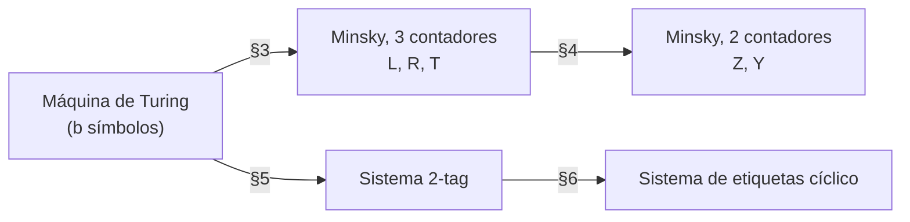

# minsky-tag

Traducciones de máquinas Turing a máquinas de Minsky, y a sistemas 2-tag.
**Teorema (Minsky 1961, 1967):** para toda máquina de Turing $M$ existe una máquina de Minsky $C_M$ con dos contadores tal que, si $C_M$ arranca con $Z = 2^{L_0}3^{R_0}$ e $Y = 0$, donde $L_0, R_0$ codifican la cinta inicial de $M$, entonces $C_M$ para si y sólo si $M$ para, y en ese caso $Z$ codifica la cinta final de $M$. Construye $C_M$ a partir de $M$ en dos traducciones + ruta paralela por sistemas de etiquetas:



## Uso

```bash
mvn test
mvn package
java -jar target/minsky-tag-1.0.jar output --trace
```

## 10. Referencias

### Técnicas

1. Minsky, M. L. (1967). *Computation: Finite and Infinite Machines*. Prentice-Hall.
2. Shepherdson, J. C. y Sturgis, H. E. (1963). Computability of recursive functions. *Journal of the ACM*, 10(2), 217-255.
3. Lambek, J. (1961). How to program an infinite abacus. *Canadian Mathematical Bulletin*, 4(3), 295-302.
4. Melzak, Z. A. (1961). An informal arithmetical approach to computability and computation.
5. Fischer, P. C., Meyer, A. R. y Rosenberg, A. L. (1968). Counter machines and counter languages. *Mathematical Systems Theory*, 2(3), 265-283.
6. Conway, J. H. (1987). FRACTRAN: A simple universal programming language for arithmetic
7. Rogozhin, Yu. (1996). Small universal Turing machines. *Theoretical Computer Science*, 168(2), 215-240.
8. Korec, I. (1996). Small universal register machines. *Theoretical Computer Science*, 168(2), 267-301.
9. Cook, M. (2004). Universality in elementary cellular automata. *Complex Systems*, 15(1), 1-40.
10. Woods, D. y Neary, T. (2006). On the time complexity of 2-tag systems and small universal Turing machines. *FOCS 2006*, IEEE, 439-448. doi:10.1109/FOCS.2006.58. arXiv:cs/0612089
11. Neary, T. y Woods, D. (2006). P-completeness of cellular automaton Rule 110. *ICALP 2006*, LNCS 4051, 132-143.
12. De Mol, L. (2008). Tag systems and Collatz-like functions. *Theoretical Computer Science*, 390(1), 92-101. doi:10.1016/j.tcs.2007.10.020
13. De Mol, L. (2011). On the complex behavior of simple tag systems: an experimental approach. *Theoretical Computer Science*, 412(1-2), 97-112.
14. Hopcroft, J. E. y Ullman, J. D. (1979). *Introduction to Automata Theory, Languages, and Computation*. 
